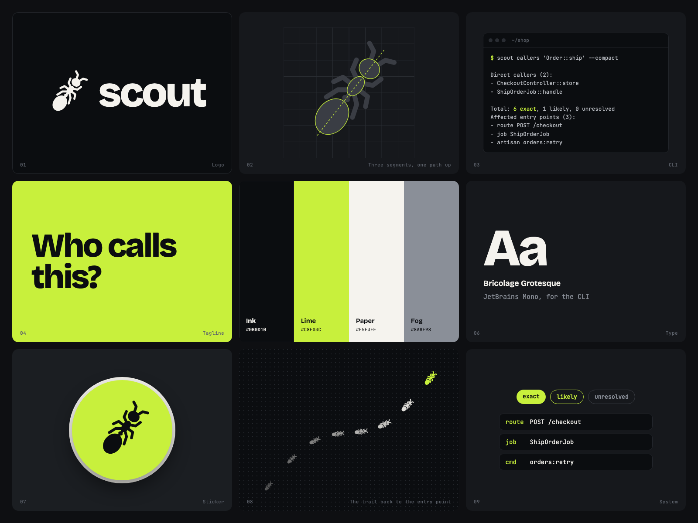

# Nhận diện scout

## Ý tưởng

Kiến trinh sát đi trước dò đường, để lại lối cho cả đàn đi theo. scout làm việc đó cho người và AI agent: lần ngược từ một hàm lên tới nơi người dùng chạm vào (route, job, lệnh).

Mark là con kiến nhìn từ trên, bò chéo lên: ba đốt nằm trên một trục, đi lên phía điểm vào.

## File

| File | Dùng cho |
|---|---|
| `mark.svg` | Mark trên nền sáng |
| `mark-light.svg` | Mark trên nền tối |
| `mark-lime.svg` | Mark màu nhấn trên nền tối |
| `icon.svg`, `icon-512.png` | Icon ứng dụng, avatar |
| `favicon.ico` | Favicon 16, 32, 48 px (bản nét dày cho cỡ nhỏ) |
| `lockup-light.svg`, `lockup-dark.svg` | Mark cùng chữ, nền sáng và nền tối (chữ đã chuyển thành nét, không cần font) |
| `lockup-light.png`, `lockup-dark.png` | Bản PNG của lockup, cho nơi không nhận SVG |

## Màu

| Tên | Mã |
|---|---|
| Ink | `#0B0D10` |
| Lime | `#C8F03C` |
| Paper | `#F5F3EE` |
| Fog | `#8A8F98` |

Lime là màu nhấn duy nhất. Không đặt chữ Lime trên nền Paper (thiếu tương phản).

## Chữ

- Chữ thương hiệu: Bricolage Grotesque, đậm 800, chữ thường.
- Lệnh và output: JetBrains Mono.

## Không làm

- Không vẽ kiến nhìn nghiêng, không thêm màu cho riêng phần đầu.
- Không xoay, kéo giãn hay đổi tỉ lệ ba đốt.
- Không đặt mark lên ảnh rối; dùng nền Ink, Paper hoặc Lime.
